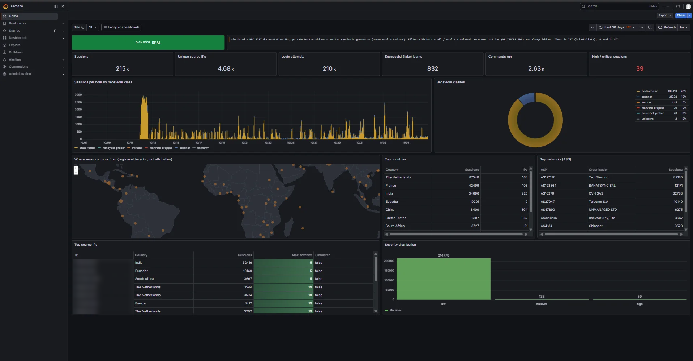
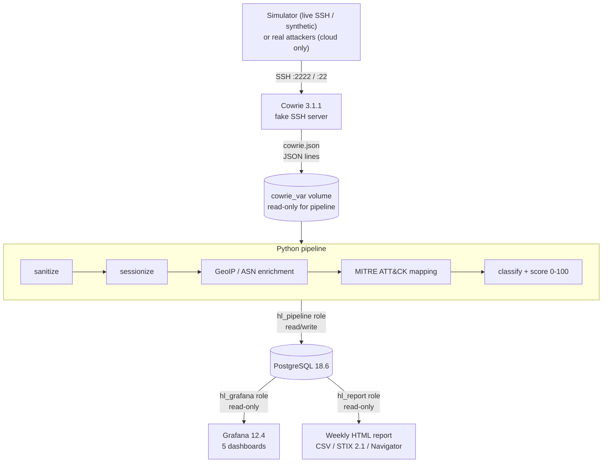
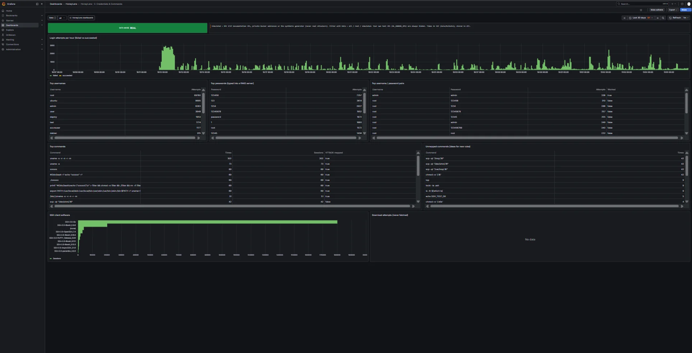
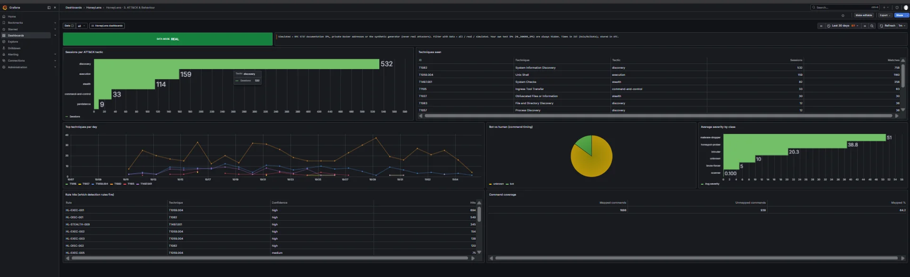
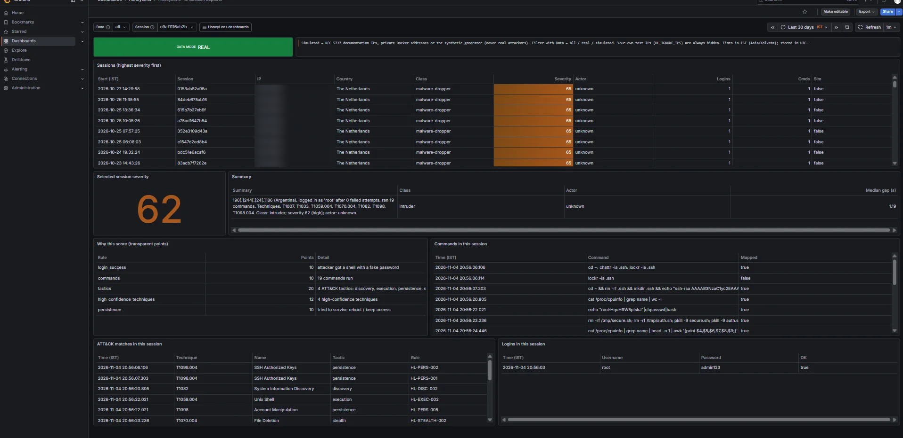
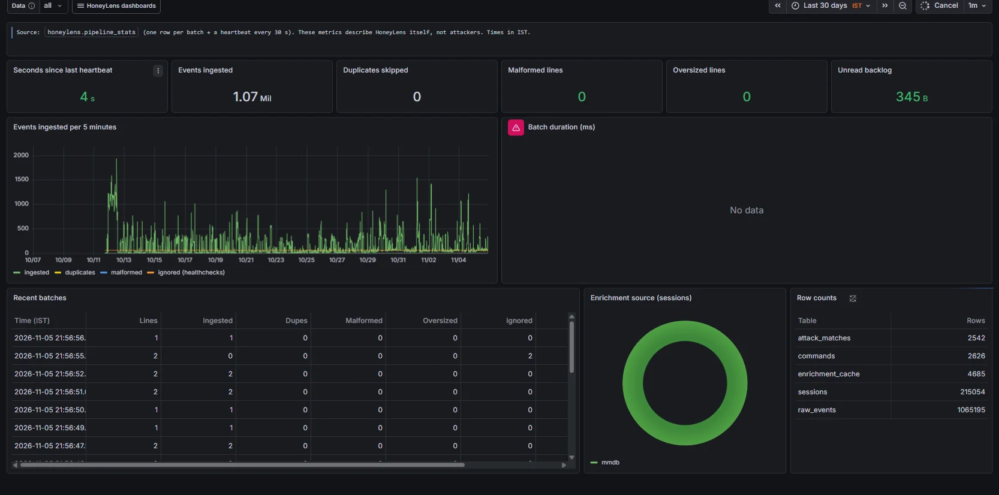

# HoneyLens

[](https://github.com/VRCHAMPION/honeylens/actions/workflows/ci.yml)
[](LICENSE)
[](pyproject.toml)

**An SSH honeypot and threat-intelligence pipeline you can run on a laptop with 3 commands.**

HoneyLens runs [Cowrie](https://github.com/cowrie/cowrie) (a fake SSH server) and reads every attacker
event. It cleans each event, adds location and network information, maps attacker commands to
**MITRE ATT&CK**, scores each session, and stores everything in **PostgreSQL**. You get five
**Grafana** dashboards plus a weekly HTML report with IOC (Indicator of Compromise) exports in CSV,
STIX 2.1 and ATT&CK Navigator formats.



> Screenshot: **REAL** attacker traffic from 25 days on Azure (source IPs blurred). See [Real-world results](#real-world-results).

> **Live deployment: Azure.** HoneyLens has been deployed and verified on an Azure for Students VM.
> See [DEPLOY_CLOUD.md](DEPLOY_CLOUD.md) for the cloud setup.

---

## Contents

- [How to use this repo](#how-to-use-this-repo)
- [Architecture](#architecture)
- [Features](#features)
- [Real-world results](#real-world-results)
- [By the numbers](#by-the-numbers)
- [Safety](#safety)
- [Limitations](#limitations)
- [Design decisions & what I learned](#design-decisions--what-i-learned)
- [Roadmap](#roadmap)
- [Documentation](#documentation)
- [Attribution](#attribution)

---

## How to use this repo

### 1. Prerequisites

| Tool | Windows | macOS | Linux |
|---|---|---|---|
| Docker | Docker Desktop (WSL 2 backend) | Docker Desktop | Docker Engine + Compose v2 |
| Python 3.11+ | python.org installer (tick "Add to PATH") | `brew install python` | your package manager |
| Git | git-scm.com | `brew install git` | your package manager |

Check that `docker compose version` prints v2.x. You'll need about 2 GB of free RAM.

### 2. Clone and configure

```bash
git clone https://github.com/VRCHAMPION/honeylens.git
cd honeylens
python scripts/make_env.py          # creates .env with random passwords (git-ignored)
```

### 3. Start the stack

```bash
docker compose up -d --build
docker compose ps                   # wait until postgres, cowrie, pipeline, grafana show (healthy)
python scripts/check_ports.py --live
curl -s http://127.0.0.1:3000/api/health      # Grafana answers on loopback: {"database": "ok", ...}
```

The `migrate` service runs once, creates the database, then exits with code 0. That is expected.
No container has internet access by default (see [Safety](#safety)).

### 4. Generate safe attack data

```bash
docker compose --profile sim run --rm simulator     # 16 real SSH sessions from 8 attacker personas
docker compose --profile sim run --rm synthetic     # 14 days of synthetic events
```

### 5. Open the dashboards

Go to **http://127.0.0.1:3000** and log in as `admin`, using `GF_ADMIN_PASSWORD` from `.env` as
the password. Open **Dashboards**, then the **HoneyLens** folder.

### 6. Attack it yourself

```bash
ssh -p 2222 root@127.0.0.1          # password: admin123
```

Try `uname -a`, `cat /etc/passwd` or `wget http://example.invalid/x`. Your commands appear in
**Session Explorer** within seconds.

### 7. Generate the weekly report

```bash
# Linux/macOS: run as your own user so the files in ./out belong to you
HL_HOST_UID=$(id -u) HL_HOST_GID=$(id -g) docker compose --profile tools run --rm report
# Windows (Docker Desktop):
docker compose --profile tools run --rm report
```

Then open `out/weekly-report.html`. To mask IPs before sharing (source IPs and any IP inside URLs,
commands and session summaries), add `honeylens-report --out /out --mask-ips` to the same command.

### 8. Run the tests

```bash
python -m venv .venv
source .venv/bin/activate           # Windows: .venv\Scripts\activate
pip install -e ".[dev]"
pytest
```

### 9. Stop

```bash
docker compose stop                 # stop, keep data
docker compose down -v              # remove everything, including the database
```

Step-by-step guide with troubleshooting: [RUN_ON_LAPTOP.md](RUN_ON_LAPTOP.md).
To put the honeypot on the internet and catch real attackers: [DEPLOY_CLOUD.md](DEPLOY_CLOUD.md).

### Real data: ignore your own IPs, re-score after rule changes

* **`HL_IGNORE_IPS`** (in `.env`, comma-separated IPs or CIDRs) lists your own test machines.
  Their sessions stay in the database but are left out of reports, IOC exports and every Grafana
  panel, and are never exported as IOCs. Example: `HL_IGNORE_IPS=203.0.113.10,198.51.100.20`.
  `HL_SENSOR_IP` (the honeypot's own public IP) is never exported as an IOC either.
* **Per-IP brute force:** a login-only session counts as `brute-forcer` when its IP made at least
  `HL_BRUTE_MIN_FAILURES` (default 20) failed logins within +/- `HL_BRUTE_WINDOW_MIN` (default 60)
  minutes across all its sessions. Bots that open one connection per guess are caught this way.
* **`honeylens-rescore`** re-matches stored commands against the current rules and re-scores
  stored sessions (class, severity, reasons, ATT&CK matches, ignore list) in batches. Raw data is
  never changed, a second run changes nothing, and `--dry-run` prints a before/after summary:

  ```bash
  docker compose exec pipeline honeylens-rescore --dry-run     # preview
  docker compose exec pipeline honeylens-rescore               # apply
  docker compose exec pipeline honeylens-rescore --since 7d    # only the last 7 days
  ```

---

## Architecture



More diagrams: [docs/ARCHITECTURE.md](docs/ARCHITECTURE.md).

## Features

| Part | What it does | Where |
|---|---|---|
| Cowrie honeypot | fake Debian 12 server, JSON logs, Telnet off, no forwarding, downloads blocked | `cowrie/` |
| Pipeline | tails logs with crash-safe offsets, handles rotation, deduplicates, batches | `src/honeylens/pipeline/` |
| Enrichment | deterministic demo data, optional offline MMDB GeoIP/ASN, database cache, optional rate-limited IPInfo API | `src/honeylens/enrich/` |
| ATT&CK mapping | 70 YAML regex rules across 9 tactics and 45 techniques (ATT&CK v19.2), matched on the raw and a de-obfuscated copy of each command | `src/honeylens/mitre/` |
| Scoring | explainable 0-100 severity, behaviour classes, per-IP brute-force window, bot vs human; `honeylens-rescore` backfills stored sessions | `src/honeylens/pipeline/scoring.py`, `rescore.py` |
| Simulator | 8 safe attacker personas, live SSH plus synthetic mode | `src/honeylens/simulator/` |
| Dashboards | SOC Overview, Credentials & Commands, ATT&CK & Behaviour, Session Explorer, Pipeline Health | `grafana/` |
| Report | weekly HTML report, IP masking, CSV, STIX 2.1 (incl. IOCs found in command text), Navigator layer | `src/honeylens/reporting/` |

## Real-world results

HoneyLens ran as an internet-facing SSH honeypot on an Azure for Students VM from **11 Oct to 5 Nov 2026**
(25 days). Every number here is **REAL** attacker traffic; my own test IPs are excluded with `HL_IGNORE_IPS`.

| Metric | Value |
|---|---|
| SSH sessions | 215,054 |
| Unique source IPs | ~4,680 |
| Login attempts | ~210,000 |
| Fake logins that "succeeded" | 832 |
| Attacker commands captured | 2,626 |
| Raw events ingested | 1.07 million (0 duplicates, 0 malformed) |
| ATT&CK technique matches | 2,542 across 13 techniques |
| High-severity sessions | 39 |
| Cloud cost | about Rs 286, covered by Azure for Students credit |

**What the attackers did**

- **SSH key backdoor campaign:** the same 19-command script, run from India, China, Kuwait, Singapore,
  Senegal and Argentina, removed `.ssh`, planted its own key in `authorized_keys` (T1098.004) and
  changed the root password.
- **Malware droppers:** bots uploaded hidden files (`.16`, `.b0s`) over SCP and used `sudo` to make them
  executable. 4 unique SHA-256 hashes were captured; nothing was ever executed.
- **Honeypot detection:** 70 sessions ran scripts that test whether the shell is fake (T1497.001).
- **Credentials:** the top password was `123456` (7,257 tries); attackers even guessed the cloud
  default username `azureuser` 1,177 times.

**Real data made the tool better.** The first weeks showed the rules missing real attacks, so I rewrote
them and re-scored all history with `honeylens-rescore` (raw evidence untouched):

| Label | Before | After |
|---|---|---|
| Brute-forcer (now judged per IP, not per session) | 1,560 | 192,398 |
| Honeypot-prober | 1 | 70 |
| High severity | 9 | 39 |

191,027 sessions were re-scored in 494 seconds.

| | |
|---|---|
|  |  |
|  |  |

Known gaps from this run: the newer SCP-upload dropper still scores only 43 (medium) because
`scp -qt` uploads have no rule yet, and two Grafana panels (Batch duration, Download attempts) showed
no data on the live VM.

## By the numbers

| Number | Where it comes from |
|---|---|
| CI: lint, PostgreSQL-backed tests, Docker integration, secret scan | all four jobs run on every push and pull request ([latest runs](https://github.com/VRCHAMPION/honeylens/actions/workflows/ci.yml)); the test job fails below 80% line + branch coverage |
| 373 tests passed, 85.69% coverage | the release commit's [hosted CI run](https://github.com/VRCHAMPION/honeylens/actions/runs/37808655086) (Python 3.12, PostgreSQL 18.6); the count grows as tests are added |
| 5 dashboards | the provisioned Grafana JSON, generated by `scripts/build_dashboards.py`; CI checks every panel returns data |
| 8 simulator personas | source and persona safety tests |
| 70 rules, 9 tactics, 45 techniques | validated against the bundled Enterprise ATT&CK v19.2 snapshot; this is rule coverage, not overall ATT&CK coverage |
| ~5,100-5,900 events/s ingest | `scripts/perf_test.py` on a 2-vCPU ARM64 VM, pipeline and PostgreSQL on the same machine; details in [docs/BENCHMARKS.md](docs/BENCHMARKS.md) |

Trivy's non-gating report lists the HIGH/CRITICAL CVEs in the images; the gate fails the build on any
fixable CRITICAL in the HoneyLens image. HoneyLens ran on a real cloud VM (Azure for Students)
from 11 Oct to 5 Nov 2026; the results are in [Real-world results](#real-world-results). The
included sample files in `docs/samples` and the screenshots in `docs/screenshots` are **SIMULATED**;
those in `docs/screenshots/real` are **REAL** (source IPs blurred).

## Safety

On a laptop, only `127.0.0.1:2222` (Cowrie) and `127.0.0.1:3000` (Grafana) are published, and CI
checks from the host that both really answer. PostgreSQL has no published port and sits on an
internal network. There's no host networking, no privileged containers and no Docker socket. The
simulator can reach loopback or an exact project service/explicit operator allow-list; unapproved
hostnames are rejected before DNS. **No container has internet access by default:** Cowrie, the
simulator and Grafana are on bridge networks with IP masquerading (outbound NAT) switched off. The
pipeline gets outbound access only if you opt in to IPInfo enrichment with
`docker compose -f docker-compose.yml -f docker-compose.enrich.yml up -d`. In the cloud, host
firewall rules re-applied at boot by a systemd unit also block Cowrie egress.
Fake data uses RFC 5737 documentation IPs and `.invalid` domains. Attacker input is treated as hostile
everywhere, and attacker URLs are never downloaded. See [SECURITY.md](SECURITY.md) and
[docs/THREAT_MODEL.md](docs/THREAT_MODEL.md).

## Limitations

HoneyLens is a low-interaction SSH honeypot and a learning/research pipeline. Its emulated shell is
not a real server. The included sample events are **SIMULATED**; a single deployment sees
only the actors that choose to connect to that address. ATT&CK matches are explainable regex
indicators with false positives and false negatives, severity is a heuristic, and GeoIP describes
network registration rather than a person's identity. The cloud deployment is **VERIFIED** on Azure
for Students (Standard B2ats_v2, Ubuntu 24.04: egress lockdown check PASS, admin SSH only over
Tailscale); the Oracle and AWS instructions are untested alternatives.

## Design decisions & what I learned

**Decisions (and where to see them in the code)**

* **Tail Cowrie's JSON log instead of using its database output plugin.** Cowrie, the
  attacker-facing process, never holds database credentials, and HoneyLens controls sanitising and
  replay. The cost is handling rotation, truncation and partial lines itself
  (`src/honeylens/pipeline/tailer.py`, `tests/test_tailer.py`).
* **Effectively-once ingest.** File offsets are written in the same PostgreSQL transaction as the
  events, and each line has a unique hash, so a crash or database outage neither loses nor
  duplicates events (`pipeline/store.py`, integration steps 5-6).
* **Clean at ingest, escape at display.** ANSI escapes, control characters, invisible Unicode format
  characters and oversized strings are removed before storage (`pipeline/sanitize.py`). HTML is
  escaped only when shown (Jinja autoescape plus a strict CSP), so the database keeps the real text.
* **Three least-privilege database roles.** Only `hl_pipeline` can write. `hl_grafana` and
  `hl_report` are read-only through grants *and* `default_transaction_read_only`
  (`db/migrations/003_grants.sql`, `005_default_privileges.sql`, `tests/test_db.py`).
* **Explainable detection over ML.** ATT&CK mapping is 70 YAML regex rules, each with positive and
  negative tests and validated against a bundled ATT&CK snapshot. Severity is a points-based score
  with stated reasons (`mitre/rules.yaml`, `pipeline/scoring.py`).
* **Dashboards as code.** The five Grafana dashboards are generated by
  `scripts/build_dashboards.py`; a test fails if the committed JSON is stale or a query uses an
  unescaped template variable.
* **Default-deny networking and hardened containers.** Non-root users, read-only root filesystems,
  `cap_drop: ALL`, `no-new-privileges`, resource limits, and no outbound NAT unless you opt in.

**What I learned (bugs this project hit and how they were fixed)**

* Docker silently skips published ports for a container attached only to `internal: true`
  networks. The internal-only network looked safest, but it broke `127.0.0.1:3000` and `:2222`.
  The fix was bridges with masquerading off, plus a host-side CI check, because the old
  integration test reached the services over Docker networks and never noticed.
* A log line still being written can be longer than the size limit. Committing the offset in
  the middle of it made the rest look like a new malformed line, so the tailer now remembers that
  it is mid-line.
* `GRANT ... ON ALL TABLES` only covers tables that already exist. Future tables need
  `ALTER DEFAULT PRIVILEGES`.
* Masking "the source IP" is not the same as masking every IP: attacker URLs and commands carry
  addresses too, including defanged ones.
* Real traffic broke three assumptions the simulator never tested. SSH bots open a new connection
  for every password guess, so per-session counting called them scanners; a per-IP time window
  fixed it. Droppers pipe `curl | sh` or pull over `scp -i key`, so Cowrie logs no download and the
  payload host was missing from the IOCs until command text was mined too. And bots probe for
  honeypots with made-up commands and `/bin/./uname` path tricks, so rules now also run on a
  normalised copy of each command.

## Roadmap

- **Done:** PostgreSQL-backed suite, Docker integration and secret scan in hosted CI, plus a
  benchmark with retained machine details ([docs/BENCHMARKS.md](docs/BENCHMARKS.md)).
- **Done:** cloud deployment on Azure for Students with the egress lockdown verified
  (`deploy/verify-egress.sh` PASS) and admin SSH over Tailscale; real-data fix pass (per-IP
  brute force, download-and-execute scoring, command-text IOCs, honeypot-probe rules, rescore tool).
- **Next:** finish the 2-4 week real-data run, then publish privacy-reviewed findings.
- **Medium term:** broaden rule evaluation with reviewed real-world command examples and add a
  repeatable end-to-end test report.
- **Optional:** support additional sensors or export destinations while preserving least privilege
  and clear simulated-versus-real data labeling.

## Documentation

| File | Contents |
|---|---|
| [RUN_ON_LAPTOP.md](RUN_ON_LAPTOP.md) | full local setup and troubleshooting |
| [DEPLOY_CLOUD.md](DEPLOY_CLOUD.md) | cloud deployment (verified on Azure for Students; Oracle and AWS alternatives untested), updating, rescoring |
| [SECURITY.md](SECURITY.md) | safety rules and how they are enforced |
| [docs/](docs/) | architecture, threat model, data dictionary, ATT&CK coverage, analyst playbook, benchmarks |

## Attribution

* MITRE ATT&CK® data © The MITRE Corporation, used under the ATT&CK Terms of Use.
* IP Geolocation by [DB-IP](https://db-ip.com) (CC BY 4.0), if you download the Lite databases.
* Cowrie © Michel Oosterhof and contributors (BSD licence).

Licence: MIT. See [LICENSE](LICENSE).
